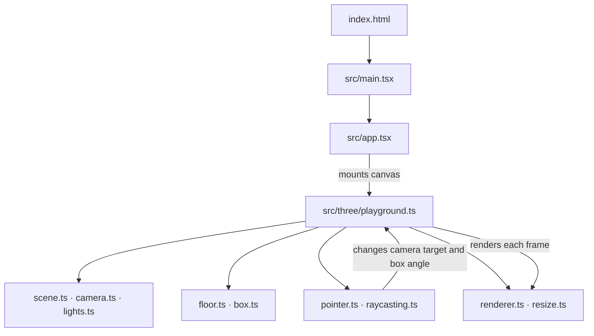

# Three Playground

A minimal Three.js learning workspace inside Semesta. React renders the canvas; raw Three.js draws one burgundy box in a pale pink world. Built with Vite, TypeScript and plain CSS.

```sh
npm install
npm run dev
```

Hover the box to enlarge it. Click or tap it to rotate by 90 degrees. Drag the empty background to move the camera across the X/Z plane. The box stays in world space.

## How the files fit together

Follow the arrows from the browser entry point to the canvas. `playground.ts` creates the Three.js objects, connects the pointer events, and runs `animate()` once per frame. React owns the canvas element; Three.js draws into it.



## File guide

| File                      | What it does                                                                                                          |
| ------------------------- | --------------------------------------------------------------------------------------------------------------------- |
| `index.html`              | Gives React its root element and loads the TypeScript entry point.                                                    |
| `src/main.tsx`            | Creates the React root and loads the global CSS.                                                                      |
| `src/app.tsx`             | Renders the canvas and starts/stops Three.js with a React effect.                                                     |
| `src/style.css`           | Makes the canvas fill the viewport and prevents touch scrolling on it.                                                |
| `src/three/playground.ts` | Assembles the scene, runs the visible animation loop, and cleans up resources. Start here to trace the Three.js code. |
| `src/three/renderer.ts`   | Creates the WebGL renderer for React's canvas and caps pixel ratio.                                                   |
| `src/three/scene.ts`      | Creates the scene and sets its pink background.                                                                       |
| `src/three/camera.ts`     | Creates the perspective camera, look target, and fixed viewing offset.                                                |
| `src/three/lights.ts`     | Creates the ambient and directional lights.                                                                           |
| `src/three/floor.ts`      | Creates the large, flat pink plane.                                                                                   |
| `src/three/box.ts`        | Creates the single burgundy box.                                                                                      |
| `src/three/raycasting.ts` | Converts pointer position to a ray and checks whether it hits the box.                                                |
| `src/three/pointer.ts`    | Handles mouse/touch hover, tap, click, and bounded background drag.                                                   |
| `src/three/resize.ts`     | Updates the camera projection and renderer when the viewport changes.                                                 |

The project files configure the tools around that runtime code:

| File                                   | What it does                                                         |
| -------------------------------------- | -------------------------------------------------------------------- |
| `package.json`                         | Lists dependencies and npm commands.                                 |
| `package-lock.json`                    | Locks exact installed dependency versions.                           |
| `vite.config.ts`                       | Enables React support in Vite.                                       |
| `tsconfig.json`                        | Sets strict TypeScript and JSX options.                              |
| `eslint.config.mjs`                    | Enforces the shared lint rules.                                      |
| `.prettierrc.json` / `.prettierignore` | Set formatting style and exclude generated files.                    |
| `.editorconfig`                        | Keeps basic editor whitespace settings consistent.                   |
| `.nvmrc`                               | Pins the Node version used for development.                          |
| `.gitignore`                           | Excludes dependencies, build output, and local files from Git.       |
| `AGENTS.md`                            | Records coding conventions for AI agents working in this repository. |
| `README.md`                            | Explains how to run and read the project.                            |

## Checks

`npm run check` runs formatting, lint, and TypeScript checks. `npm run build` creates the production bundle.

```sh
npm run check
npm run build
npm run preview
```

Code style and agent conventions are in `AGENTS.md`.
