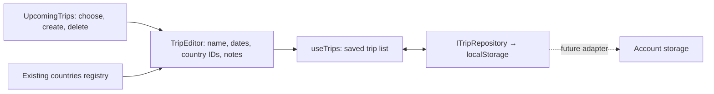
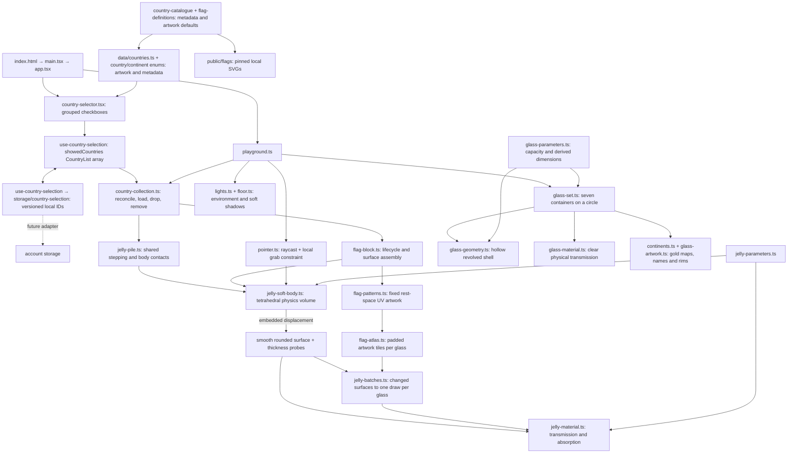

# Semesta

semesta means universe in Bahasa Indonesia. My mother tongue.
embarking my creative journey leveraging my background in Frontend engineering
into interactive digital arts✨

each semesta will be a personal space journey telling hidden stories but at the same time embedding a real app that i build on spare time

# Let's begin

A minimal Three.js learning workspace inside Semesta. React renders the canvas and one bottom country checklist; raw Three.js drops selected miniature gummy flags into seven open continent glasses in a pale pink world. Built with Vite, TypeScript and plain CSS.

```sh
npm ci
npm run dev
```

The same playground is available at `/` and `/countryjellies/`.

Open **Countries** at the bottom to search and tick any of the 195 states (193 UN members plus the Holy See and Palestine), grouped by continent. Indonesia is selected on a first visit. Selections, including an intentionally empty selection, survive reloads in this browser. Ticking a country queues one miniature jelly into its continent glass; unticking removes it, including during loading or grabbing. All 195 can be selected together; large selections fill gradually to keep input responsive. Antarctica has no state in this catalogue, so its glass stays empty. Grab a region to stretch a jelly, then release to let it settle. Drag a glass to rotate the circle; drag the background to pan and use the wheel to zoom. Panning follows ground-plane ray intersections at the current zoom and can reach every glass within the composition bounds plus a small margin. Two-finger dragging pans over glasses; changing the finger spacing zooms. Touch updates are combined once per frame to avoid accidental zoom during a parallel drag. Mouse and touch use Pointer Events. Wheel/trackpad zoom and two-finger touch pinch share proportional camera zoom and the same distance limits. Spreading fingers zooms in; bringing them together zooms out. Starting a pinch cancels a local grab without launching the jelly, and one-finger movement stays paused until all fingers lift. `zoom.ts` normalizes wheel units; `pointer.ts` tracks the touch pair; `pan.ts` maps screen movement to the ground and defines the travel margin.

The token at the top right shows FPS and average milliseconds per frame, sampled from the scene loop once per second. Green **Butter mode** means at least 50 FPS, amber **Jelly legs** means 30–49 FPS, and red **Potato mode** means below 30 FPS. Hidden-tab pauses reset sampling. This measures frame pacing; it does not isolate CPU or GPU cost. Thresholds and labels live in `src/performance/frame-monitor.ts`.

## Upcoming trips MVP

**Upcoming trips** opens a glass timeline panel on the right on desktop. On mobile, the bottom **Countries / Trips** bar opens one bottom sheet at a time. Browsing uses a half-height sheet; trip details and editing expand it to nearly the full visible screen. Close, Escape, or a backdrop tap dismisses the sheet. Drafts survive dismissal and switching sheets; the scene cannot receive gestures while a sheet is open. The form scrolls above fixed actions, and sheet height follows the visual viewport when a keyboard opens. Dated trips appear chronologically, with undated trips last. Rows show compact dates and a circular flag thumbnail for the first destination; the **+** button creates a trip. Select a row to see its destinations and notes, edit it, or delete with confirmation. **All trips** returns to the timeline. Use **Save trip** to keep changes. Collapsing the panel retains the current draft, but reloading discards unsaved edits.

Trips are separate from the cups: planning or deleting a trip never changes selected jellies. Destinations reuse the existing country registry and `CountryList` IDs. Trips are saved only in this browser under `semesta.upcoming-trips`; they do not sync across devices. Storage failures show a session-only warning. `ITripRepository` can later be backed by account storage without changing the panel.



## How the files fit together



## Implementation and tuning

- **Physics:** each body has 24 particles and 36 tetrahedra. Distance constraints resist shear/stretch; signed tetrahedral volume constraints resist collapse. Velocities provide inertia and release overshoot. The fixed step is 1/60 second with at most three substeps per frame. All particles can move. Recovery follows the body centre; floor collision, friction, and restitution handle landing. Click/tap or release a drag to hop; cancelling a gesture does not launch it. The recovery force keeps the slab broadly upright. Each continent uses one shared stepper. A vertical sweep limits candidate pairs, and conservative body bounds handle contacts between jellies. The lower body supports the upper body; horizontal contacts separate overlapping bounds. This makes dense stacks stable without particle-to-tetrahedron collision tests. Contacts between bodies are approximate and do not reproduce interlocking soft surfaces. Settled bodies sleep; tiny resting contacts no longer restart their sleep timers. A grab wakes its body; meaningful contacts wake impacted neighbours. Removing support wakes its connected pile while distant bodies remain asleep. Unchanged visible surfaces skip buffer updates. Radial walls, the interior base and a headroom ceiling keep particles in their glass. This is an approximate CPU contact solver, not a production rigid-body engine.
- **Surface:** a rounded mesh follows the volume through trilinear embedding. Its positions and smooth normals update in place. A shared CPU rest template avoids rebuilding identical rounded geometry. Each jelly still owns independent deformation buffers. Every country uses the same 1.98 × 1.32 × 1 source dimensions, configured in `jellyParameters.surface`, scaled to 30% inside the glasses. Absorption and grab distances scale with the miniature bodies. There is no separate rigid flag or global sine wobble.
- **Flag:** the catalogue supplies name, continent and native artwork dimensions. `flag-definitions.ts` supplies shared SVG defaults and the four established procedural palette overrides. Complex emblems use the same local SVG-to-canvas renderer. Artwork keeps its national aspect ratio inside identical slabs; the background surround is pink unless explicitly overridden. Rest-space UVs are fixed, so the artwork stretches with the jelly. Pinned asset and metadata provenance is in `public/flags/README.md`.
- **Material:** paired points embedded on the front/back of the volume estimate local thickness. This drives native physical transmission and Beer–Lambert colour absorption. It is a local-volume approximation, **not** a camera-ray back-face-depth pass; overlapping folds are not resolved. Roughness softens the highlights; the shadow-receiving floor grounds the bodies.
- **Compatibility:** this remains raw Three.js WebGL inside React, with no R3F/Drei. Tetrament was audited: it requires WebGPU compute/node materials, its npm name returned 404, and the Git repository's declared `dist` entry was absent. This project uses a small CPU position-based tetrahedral solver rather than adding an unpublished GPU dependency. It is not FEM and does not claim Tetrament feature parity.

Jelly controls are in `src/three/jelly-flags/jelly-parameters.ts`; drop spacing and contact settings are in `jelly-pile.ts`:

| Desired change           | Parameter                                                          |
| ------------------------ | ------------------------------------------------------------------ |
| Softer                   | Lower `physics.stiffness` and `physics.recovery`                   |
| Firmer                   | Increase `physics.stiffness` or `physics.iterations`               |
| More jiggle              | Lower `physics.damping` (keep it positive)                         |
| Better volume retention  | Increase `physics.volumePreservation` or solver iterations         |
| Stronger local grab      | Increase `physics.grabStrength`; keep `maxStretch` bounded         |
| More translucent         | Increase `material.transmission`, lower `material.absorption`      |
| More gummy / less glassy | Increase `material.roughness` and `material.absorption` moderately |

Rendering starts at pixel ratio 1 and can step down to 0.875 or 0.75 after sustained slow frames. Sustained headroom restores resolution, with separate thresholds to prevent oscillation. Resize preserves the current quality level. `render-parameters.ts` controls this small range; HTML stays at native resolution. Three.js renders its internal refraction buffer at half resolution independently of the main canvas. Shadow maps refresh when a jelly surface or membership changes, the glass circle turns, or camera movement changes the flags’ orientation. They are reused while the composition is still. Visible surfaces use three rounded subdivisions (588 triangles per jelly), and flag textures are 128 pixels high. The shared rest template, texture size, loading cadence, awake-body admission threshold and 15 Hz shadow-update limit live in `jelly-performance.ts`. Sleeping bodies retain their physics/picking meshes and skip simulation and surface updates. `jelly-batches.ts` copies changed surfaces into one render mesh per populated glass. `flag-atlas.ts` packs each glass's selected artwork into a growing texture atlas, preserving rest-space UVs and avoiding neighbouring tile bleed. These six batches also cast the shadows. The original individual meshes stay available for accurate raycasting but are hidden from rendering. Removing a country compacts the batch; removing the final country disposes that glass's GPU buffers and atlas. The atlas reallocates GPU storage when its dimensions change. This reduces draw calls without freezing interactive bodies.

The existing `camera.ts`, `scene.ts`, `renderer.ts`, and `resize.ts` keep the Three.js pieces explicit. React owns the selected enum IDs through `use-country-selection.ts`; rendering and physics stay outside React. The registry drives both the checklist and the flags. `country-collection.ts` reconciles IDs, bounds artwork construction to one load at a time, spreads drops across each glass, and slows insertion while a pile is active, with an admission target of 12 awake bodies globally and a bounded pause so loading cannot stall. Contacts may wake additional existing bodies; the limit controls new drops, never freezes active grabs. It cancels stale loads and releases resources when countries are removed. Failed artwork leaves the saved choice checked; untick and tick to retry.

`storage/country-selection.ts` is the only module that accesses localStorage. The key `semesta.country-selection` holds `{version: 1, selectedCountryIds: ["ID", "FR"]}`. IDs are validated, deduplicated and restored in canonical order. Invalid records fall back to Indonesia; empty arrays remain empty. If storage is disabled, selections work in memory. Hydration completes before any jelly is requested. The asynchronous `ICountrySelectionRepository` (`load`/`save`) allows a later API adapter without changing the selector or scene. Only choices are persisted, not physics positions or load status. Browser storage is per origin/device; this does not sync accounts or other tabs automatically.

## Checks

Glass sizing is configured in `src/three/glasses/glass-parameters.ts`. The original sizing estimated 60 jellies at 30% of the current flag dimensions, using 50% loose-pile packing and a 10% top buffer. A 1.25 width multiplier now widens the interior to approximately 2.438 units while keeping its 3.149-unit height and 0.315 units of headroom. The intended content limit remains 60; the larger volume estimates space for about 94 under the same packing assumptions. Selected countries now fall into a loose physical pile. The catalogue has 54 African, 48 Asian, 44 European, 23 North American, 14 Oceanian and 12 South American states, each within the selection limit. See `docs/performance.md` for the measured all-country run and the collision approximation used to make it practical.

The seven glasses sit on a 4.5-unit circle and share shell, plating and rim geometry. Gold maps and names face the camera as the circle turns. A local-height shader fades amber at the base to clear glass at 45% height. Gradient, plating and width settings are in the same configuration object. Continent masks are local SVG assets derived from public-domain Natural Earth outlines; their provenance is recorded in `src/three/glasses/assets/README.md`. Accessible continent descriptions accompany the canvas in HTML. Camera bounds include the wider glasses and plating throughout a complete rotation.

The glass combines physical transmission with light alpha blending because the WebGL transmission buffer omits the other transmissive jelly objects. This keeps the flags visible behind glass; refraction between overlapping transparent objects remains approximate.

`npm run check` runs formatting, lint, TypeScript checks, and the Vitest regression specs. Specs live beside their source files as `*.spec.ts`; pointer, collection lifecycle, checklist and camera specs use jsdom while geometry and capacity specs run in Node. These test behaviour and geometry, not GPU rendering or visual appearance. `npm run build` creates the production bundle.

```sh
npm run check
npm run test
npm run test:watch
npm run build
npm run preview
# With npm run dev already running and Chrome installed:
npm run test:browser
npm run benchmark
```

Code style and agent conventions are in `AGENTS.md`.

## Flag colour references

The palette audit uses the [German federal government's digital national colours](https://styleguide.bundesregierung.gov.de/sg-de/basiselemente/farben) for Germany and the [country-flags artwork collection](https://github.com/hampusborgos/country-flags/tree/main/svg) for the other flags. These are sRGB texture inputs, not guaranteed final screen colours under the jelly material.

| Country    | Texture palette                            | Audit result                                                                                                                                          |
| ---------- | ------------------------------------------ | ----------------------------------------------------------------------------------------------------------------------------------------------------- |
| Germany    | `#000000`, `#FF0000`, `#FFCC00`            | Corrected red from `#DD0000` and gold from `#FFCE00` to the federal digital palette.                                                                  |
| France     | `#051440`, `#FFFFFF`, `#EC1920`            | Changed blue from `#0055A4` to the navy in the provider's `fr.svg`; exact shades are an artwork choice.                                               |
| Indonesia  | `#FF0000`, `#FFFFFF`                       | Matches the provider's `id.svg`; retained.                                                                                                            |
| Poland     | `#FFFFFF`, `#DC143C`                       | Matches the provider's `pl.svg`; retained as a digital approximation, not a certified conversion of the statutory colour specification.               |
| Kazakhstan | `#00AFCA`, `#FEC50C`                       | Inspected fills in `kz.svg`; sky-blue field and gold details match the official colour description.                                                   |
| Brunei     | `#F7E017`, `#FFFFFF`, `#000000`, `#CF1126` | Inspected fills in `bn.svg`; yellow, white, black, and red match the official colour description.                                                     |
| Nepal      | `#DC143C`, `#003893`, `#FFFFFF`            | Inspected fills in `np.svg`; crimson, deep blue, and white match the constitutional description. The pink surround is part of the scene presentation. |

Official descriptions establish colour families without necessarily providing screen hex values: [France](https://www.elysee.fr/en/french-presidency/the-french-flag), [Indonesia](https://kab-nduga.kpu.go.id/blog/read/8404_makna-bendera-merah-putih), [Poland](https://eli.gov.pl/eli/DU/2024/155/ogl/pol), [Kazakhstan](https://mirror.akorda.kz/public/en/state_symbols/kazakhstan_flag), [Brunei](https://www.agc.gov.bn/SitePages/National%20Flag%20and%20Crest.aspx), and [Nepal](https://cdn.nestjs.wipolex.wji.prd.web1.wipo.int/wipolex/en/legislation/details/16153). SVG sources are pinned and served locally; changing upstream artwork requires an explicit asset update.

The texture is marked as sRGB. `jelly-material.ts` then applies colour-dependent absorption and transmission, while the pink surroundings and tinted reflection panels in `lights.ts` can shift its appearance. Source palette accuracy and the final illuminated appearance are separate checks; a large visible gold shift cannot be explained by the two-level green-channel correction alone. This audit preserves the existing jelly shading.

## Deployment

Vercel hosts the static Vite build. Import the personal GitHub repository into a Hobby project, set the production branch to `master`, and keep the root directory at the repository root. `vercel.json` installs with the pinned npm 11 version, runs lint, TypeScript and tests before the build, and publishes `dist`. Formatting is checked by GitHub CI; it is kept out of Vercel’s build because the host reported its copy of `vercel.json` as unformatted despite the committed file passing CI. No environment variables are required. Both `/` and `/countryjellies/` are generated HTML routes; flag SVGs are served from `/flags/`.

Pull requests get preview deployments; merges into `master` deploy production. Vercel's Git connection must be authorized through your account before the first deployment. The Hobby plan is intended for personal, non-commercial use. Selection storage is scoped to the deployed origin, so localhost selections do not transfer to the production domain.

## Interface design

The DOM interface follows [Rose Glass](docs/design-system.md): shared glass surfaces, consistent 44px controls, burgundy actions and serif headings. Design values live in `src/styles/tokens.css`; reusable controls and recipes live in `src/components/ui/`. Read the guide before adding UI. Native calendar/option popups retain the browser's own appearance.
