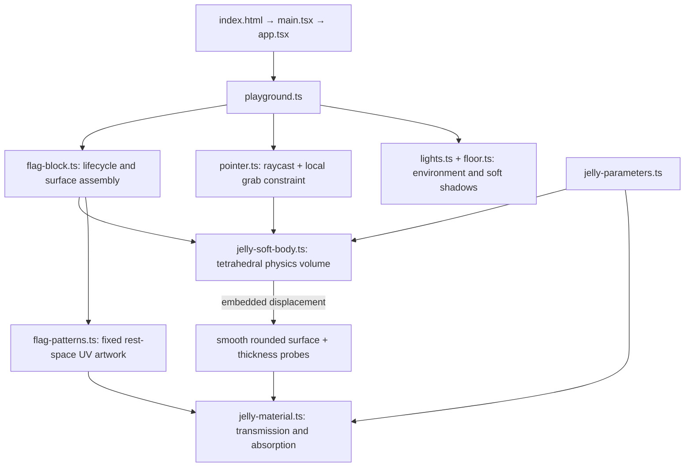

# Semesta

semesta means universe in Bahasa Indonesia. My mother tongue.
embarking my creative journey leveraging my background in Frontend engineering
into interactive digital arts✨

each semesta will be a personal space journey telling hidden stories but at the same time embedding a real app that i build on spare time

# Let's begin

A minimal Three.js learning workspace inside Semesta. React renders the canvas and country selectors; raw Three.js draws two deformable gummy flags in a pale pink world. Built with Vite, TypeScript and plain CSS.

```sh
npm install
npm run dev
```

The same playground is available at `/` and `/countryjellies/`.

Select Indonesia, France, or Nepal for either flag. Grab a region to stretch the jelly, then release to let it settle. Drag the empty background to pan; use the wheel to zoom. Mouse and touch use the same Pointer Events.

## How the files fit together



## Implementation and tuning

- **Physics:** each body has 189 particles and 576 tetrahedra. Distance constraints resist shear/stretch; signed tetrahedral volume constraints resist collapse. Velocities provide inertia and release overshoot. The fixed step is 1/120 second with at most six substeps per frame. Bottom particles anchor the contact patch; this is a grounded object, not a freely tumbling body. No inter-body collision solver is included.
- **Surface:** a dense rounded mesh follows the volume through trilinear embedding. Its positions and smooth normals update in place. The visible depth is 0.24, about 18% of its height. There is no separate rigid flag or global sine wobble.
- **Flag:** Indonesia and France are generated as colour bands; Nepal retains its existing SVG artwork on the gummy slab. UVs are assigned once from rest-space XY, including the edges, so they stretch with the material rather than swimming.
- **Material:** paired points embedded on the front/back of the volume estimate local thickness. This drives native physical transmission and Beer–Lambert colour absorption. It is a local-volume approximation, **not** a camera-ray back-face-depth pass; overlapping folds are not resolved. Roughness softens the highlights; the shadow-receiving floor grounds the bodies.
- **Compatibility:** this remains raw Three.js WebGL inside React, with no R3F/Drei. Tetrament was audited: it requires WebGPU compute/node materials, its npm name returned 404, and the Git repository's declared `dist` entry was absent. This project uses a small CPU position-based tetrahedral solver rather than adding an unpublished GPU dependency. It is not FEM and does not claim Tetrament feature parity.

Main controls are in `src/three/jelly-parameters.ts`:

| Desired change           | Parameter                                                          |
| ------------------------ | ------------------------------------------------------------------ |
| Softer                   | Lower `physics.stiffness` and `physics.recovery`                   |
| Firmer                   | Increase `physics.stiffness` or `physics.iterations`               |
| More jiggle              | Lower `physics.damping` (keep it positive)                         |
| Better volume retention  | Increase `physics.volumePreservation` or solver iterations         |
| Stronger local grab      | Increase `physics.grabStrength`; keep `maxStretch` bounded         |
| More translucent         | Increase `material.transmission`, lower `material.absorption`      |
| More gummy / less glassy | Increase `material.roughness` and `material.absorption` moderately |

The existing `camera.ts`, `scene.ts`, `renderer.ts`, and `resize.ts` keep camera, background, renderer, and resizing explicit. `app.tsx` owns only the canvas and selectors; no React state updates occur per physics frame. Country changes rebuild only the affected body, and cleanup disposes its geometry/material/texture plus scene lighting resources.

## Checks

`npm run check` runs formatting, lint, and TypeScript checks. `npm run build` creates the production bundle.

```sh
npm run check
npm run build
npm run preview
```

Code style and agent conventions are in `AGENTS.md`.
