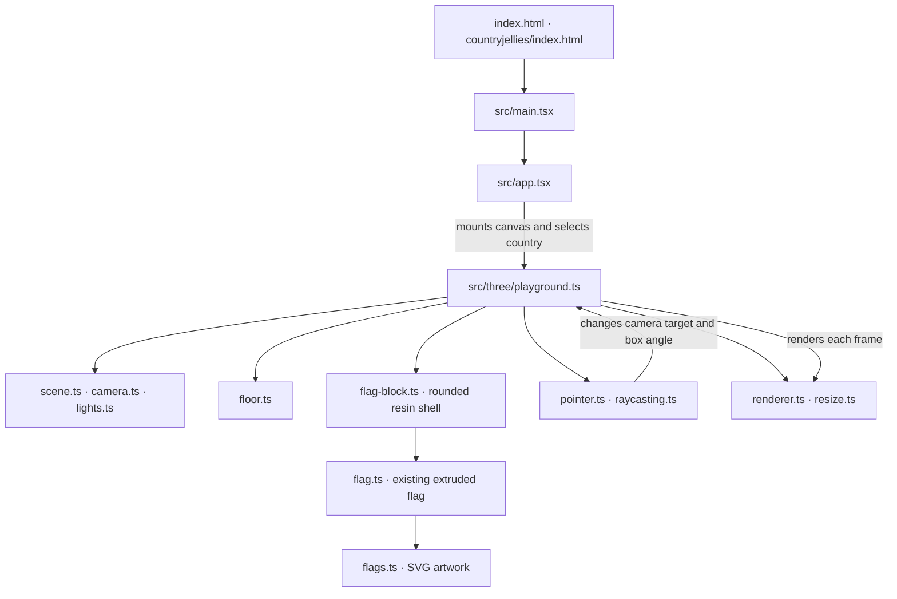

# Semesta

semesta means universe in Bahasa Indonesia. My mother tongue.
embarking my creative journey leveraging my background in Frontend engineering
into interactive digital arts✨

each semesta will be a personal space journey telling hidden stories but at the same time embedding a real app that i build on spare time

# Let's begin

A minimal Three.js learning workspace inside Semesta. React renders the canvas and country selectors; raw Three.js draws two flag-in-resin objects in a pale pink world. Built with Vite, TypeScript and plain CSS.

```sh
npm install
npm run dev
```

The same playground is available at `/` and `/countryjellies/`.

Select Indonesia, France, or Nepal for either flag. Hover either block to gently enlarge that block, click or tap it to rotate the composition, and drag the empty background to move the camera across the X/Z plane. The flags stay in world space.

The outline in `flags.ts` determines the actual shape of the solid. `flag.ts` turns that outline into a `Shape` and gives it thickness with `ExtrudeGeometry`. The SVG artwork is mapped directly onto the front and back faces; the extruded edges have their own material. There is no separate image plane in front of the object. Adding another flag means adding its artwork and outline data, then using the same builder.

`flag-block.ts` wraps each unchanged flag in a rounded, gently inflated resin shell. The flag stays at local Z = 0 with clearance on both sides. Only the shell breathes; the flag artwork and geometry stay still inside it.

Tune the look in that file:

- **Shape:** `RoundedBoxGeometry` corner radius (`0.3`) and `bulge` (`0.26`). Welded vertices give the inflated shell smooth normals.
- **Material:** `ior: 1.32` and `thickness: 0.38` control refraction; `roughness: 0.12` controls frostiness. Material thickness is an optical setting, separate from geometry depth.
- **Holographic edges:** native `iridescence` plus a small Fresnel rim in `onBeforeCompile`. `edgeStrength` controls this artistic tint; it fades out towards the centre. No environment map or extra rendering pass is added.
- **Motion:** `update()` gently changes only the shell scale (0.6% breathing amplitude) and anchors its bottom to the floor. Hover adds a little depth. `playground.ts` calls it from the existing render loop.

## How the files fit together

Follow the arrows from the browser entry point to the canvas. `playground.ts` creates the Three.js objects, connects the pointer events, and runs `animate()` once per frame. React owns the canvas element; Three.js draws into it.



## File guide

| File                                       | What it does                                                                                                                                                 |
| ------------------------------------------ | ------------------------------------------------------------------------------------------------------------------------------------------------------------ |
| `index.html` / `countryjellies/index.html` | Provide the same React entry point at `/` and `/countryjellies/`.                                                                                            |
| `src/main.tsx`                             | Creates the React root and loads the global CSS.                                                                                                             |
| `src/app.tsx`                              | Renders the canvas and country selector, then starts/stops Three.js with a React effect.                                                                     |
| `src/style.css`                            | Makes the canvas fill the viewport and prevents touch scrolling on it.                                                                                       |
| `src/three/playground.ts`                  | Assembles the scene, runs the visible animation loop, and cleans up resources. Start here to trace the Three.js code.                                        |
| `src/three/renderer.ts`                    | Creates the WebGL renderer for React's canvas and caps pixel ratio.                                                                                          |
| `src/three/scene.ts`                       | Creates the scene and sets its pink background.                                                                                                              |
| `src/three/camera.ts`                      | Creates the perspective camera, look target, and fixed viewing offset.                                                                                       |
| `src/three/lights.ts`                      | Creates the ambient and directional lights.                                                                                                                  |
| `src/three/floor.ts`                       | Creates the large, flat pink plane.                                                                                                                          |
| `src/three/flags.ts`                       | Holds each flag's artwork URL, proportions, outline, and edge color.                                                                                         |
| `src/three/flag-block.ts`                  | Groups the existing flag with rounded geometry and its translucent physical material.                                                                        |
| `src/three/flag.ts`                        | Extrudes the selected outline into a solid and maps artwork onto its front and back.                                                                         |
| `src/assets/flags/`                        | Holds local reference SVGs; the current flag definitions load URLs. Nepal's SVG is adapted from [flag-icons](https://github.com/lipis/flag-icons) under MIT. |
| `src/three/raycasting.ts`                  | Converts pointer position to a ray and checks whether it hits the box.                                                                                       |
| `src/three/pointer.ts`                     | Handles mouse/touch hover, tap, click, and bounded background drag.                                                                                          |
| `src/three/resize.ts`                      | Updates the camera projection and renderer when the viewport changes.                                                                                        |

The project files configure the tools around that runtime code:

| File                                   | What it does                                                         |
| -------------------------------------- | -------------------------------------------------------------------- |
| `package.json`                         | Lists dependencies and npm commands.                                 |
| `package-lock.json`                    | Locks exact installed dependency versions.                           |
| `vite.config.ts`                       | Enables React support in Vite.                                       |
| `tsconfig.json`                        | Sets strict TypeScript and JSX options.                              |
| `eslint.config.mjs`                    | Enforces the shared lint rules.                                      |
| `.prettierrc.json` / `.prettierignore` | Set formatting style and exclude generated files.                    |
| `.editorconfig`                        | Keeps basic editor whitespace settings consistent.                   |
| `.nvmrc`                               | Pins the Node version used for development.                          |
| `.gitignore`                           | Excludes dependencies, build output, and local files from Git.       |
| `AGENTS.md`                            | Records coding conventions for AI agents working in this repository. |
| `README.md`                            | Explains how to run and read the project.                            |

## Checks

`npm run check` runs formatting, lint, and TypeScript checks. `npm run build` creates the production bundle.

```sh
npm run check
npm run build
npm run preview
```

Code style and agent conventions are in `AGENTS.md`.
