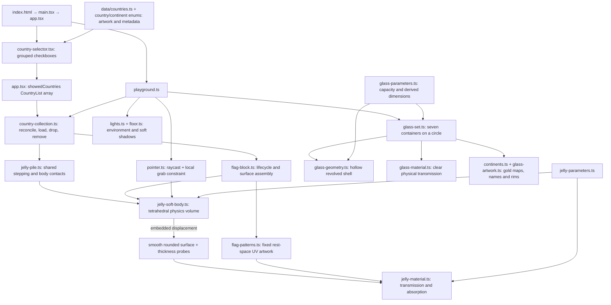

# Semesta

semesta means universe in Bahasa Indonesia. My mother tongue.
embarking my creative journey leveraging my background in Frontend engineering
into interactive digital arts✨

each semesta will be a personal space journey telling hidden stories but at the same time embedding a real app that i build on spare time

# Let's begin

A minimal Three.js learning workspace inside Semesta. React renders the canvas and one bottom country checklist; raw Three.js drops selected miniature gummy flags into seven open continent glasses in a pale pink world. Built with Vite, TypeScript and plain CSS.

```sh
npm ci
npm run dev
```

The same playground is available at `/` and `/countryjellies/`.

Open **Countries** at the bottom to tick Indonesia, France, Nepal, Germany, Poland, Kazakhstan, or Brunei, grouped by continent. Indonesia starts selected. Ticking a country drops one miniature jelly into its continent glass; unticking removes it, even while it is loading or being grabbed. Selection resets on reload. Grab a region to stretch the jelly, then release to let it settle. Drag a glass left or right to rotate the entire circle like a lazy Susan; the glasses stay on the floor and stop when released. Drag the empty background to pan; use the wheel to zoom. Mouse and touch use the same Pointer Events.

The token at the top right shows FPS and average milliseconds per frame, sampled from the scene loop once per second. Green **Butter mode** means at least 50 FPS, amber **Jelly legs** means 30–49 FPS, and red **Potato mode** means below 30 FPS. Hidden-tab pauses reset sampling. This measures frame pacing; it does not isolate CPU or GPU cost. Thresholds and labels live in `src/performance/frame-monitor.ts`.

## How the files fit together



## Implementation and tuning

- **Physics:** each body has 60 particles and 144 tetrahedra. Distance constraints resist shear/stretch; signed tetrahedral volume constraints resist collapse. Velocities provide inertia and release overshoot. The fixed step is 1/60 second with at most three substeps per frame. All particles can move. Recovery follows the body centre; floor collision, friction, and restitution handle landing. Click/tap or release a drag to hop; cancelling a gesture does not launch it. The recovery force keeps the slab broadly upright. Each continent uses one shared stepper. Particle/tetrahedron containment and nearest boundary-triangle contacts transfer positional corrections between overlapping bodies; a spatial hash and body bounds limit candidate checks. Settled bodies sleep; tiny resting contacts no longer restart their sleep timers. A grab, meaningful impact or removed support wakes touching neighbours while distant bodies remain asleep. Unchanged visible surfaces skip buffer updates. Radial walls, the interior base and a headroom ceiling keep particles in their glass. This is an approximate CPU contact solver, not a production rigid-body engine.
- **Surface:** a dense rounded mesh follows the volume through trilinear embedding. Its positions and smooth normals update in place. Every country uses the same 1.98 × 1.32 × 1 source dimensions, configured in `jellyParameters.surface`, scaled to 30% inside the glasses. Absorption and grab distances scale with the miniature bodies. There is no separate rigid flag or global sine wobble.
- **Flag:** Country definitions select a shared `stripes` or `svg` pattern. Indonesia, France, Germany, and Poland supply ordered colours and stripe orientation; Kazakhstan, Brunei, and Nepal supply SVG artwork. SVG backgrounds and proportional insets are explicit per flag, preserving Nepal’s pink surround. Each country stores relative `size.width` and `size.height` dimensions (for example, France is 3:2 and Germany is 5:3). Texture resolution retains these source proportions; every texture is mapped to the same display slab dimensions, so flags with different native ratios are resized to fit. Outlines remain separate from artwork. UVs are assigned once from rest-space XY, including the edges, so they stretch with the material rather than swimming.
- **Material:** paired points embedded on the front/back of the volume estimate local thickness. This drives native physical transmission and Beer–Lambert colour absorption. It is a local-volume approximation, **not** a camera-ray back-face-depth pass; overlapping folds are not resolved. Roughness softens the highlights; the shadow-receiving floor grounds the bodies.
- **Compatibility:** this remains raw Three.js WebGL inside React, with no R3F/Drei. Tetrament was audited: it requires WebGPU compute/node materials, its npm name returned 404, and the Git repository's declared `dist` entry was absent. This project uses a small CPU position-based tetrahedral solver rather than adding an unpublished GPU dependency. It is not FEM and does not claim Tetrament feature parity.

Jelly controls are in `src/three/jelly-flags/jelly-parameters.ts`; drop spacing and contact settings are in `jelly-pile.ts`:

| Desired change           | Parameter                                                          |
| ------------------------ | ------------------------------------------------------------------ |
| Softer                   | Lower `physics.stiffness` and `physics.recovery`                   |
| Firmer                   | Increase `physics.stiffness` or `physics.iterations`               |
| More jiggle              | Lower `physics.damping` (keep it positive)                         |
| Better volume retention  | Increase `physics.volumePreservation` or solver iterations         |
| Stronger local grab      | Increase `physics.grabStrength`; keep `maxStretch` bounded         |
| More translucent         | Increase `material.transmission`, lower `material.absorption`      |
| More gummy / less glassy | Increase `material.roughness` and `material.absorption` moderately |

Rendering is capped at pixel ratio 1 in `render-parameters.ts`, including after resize. This trades some canvas sharpness on Retina displays for four times fewer pixels than ratio 2; HTML remains at native resolution. Shadow maps refresh when a jelly surface or membership changes, the glass circle turns, or camera movement changes the flags’ orientation. They are reused while the composition is still. The visible rounded surface retains its original resolution despite the simpler internal physics grid.

The existing `camera.ts`, `scene.ts`, `renderer.ts`, and `resize.ts` keep camera, background, renderer, and resizing explicit. `app.tsx` owns `showedCountries: CountryList[]` and loading/error status; no React state updates occur per physics frame. `data/countries.ts` is the sole enum-keyed registry for names, continents and flag patterns; checkbox groups derive from it. `country-collection.ts` reconciles IDs without rebuilding other bodies, queues drops 0.25 seconds apart per glass, ignores stale loads, releases removed grabs and disposes removed resources. Texture failures untick the country and allow retry. Scene cleanup cancels pending insertion and disposes geometry/material/texture and lighting resources.

## Checks

Glass sizing is configured in `src/three/glasses/glass-parameters.ts`. The original sizing estimated 60 jellies at 30% of the current flag dimensions, using 50% loose-pile packing and a 10% top buffer. A 1.25 width multiplier now widens the interior to approximately 2.438 units while keeping its 3.149-unit height and 0.315 units of headroom. The intended content limit remains 60; the larger volume estimates space for about 94 under the same packing assumptions. Selected countries now fall into a loose physical pile. The current seven-country catalogue is tested; the volume estimate and selection cap of 60 are not a claim that 60 simultaneous soft bodies have been performance-validated. Further catalogue expansion needs profiling.

The seven glasses sit on a 4.5-unit circle and share shell, plating and rim geometry. Gold maps and names face the camera as the circle turns. A local-height shader fades amber at the base to clear glass at 45% height. Gradient, plating and width settings are in the same configuration object. Continent masks are local SVG assets derived from public-domain Natural Earth outlines; their provenance is recorded in `src/three/glasses/assets/README.md`. Accessible continent descriptions accompany the canvas in HTML. Camera bounds include the wider glasses and plating throughout a complete rotation.

The glass combines physical transmission with light alpha blending because the WebGL transmission buffer omits the other transmissive jelly objects. This keeps the flags visible behind glass; refraction between overlapping transparent objects remains approximate.

`npm run check` runs formatting, lint, TypeScript checks, and the Vitest regression specs. Specs live beside their source files as `*.spec.ts`; pointer, collection lifecycle, checklist and camera specs use jsdom while geometry and capacity specs run in Node. These test behaviour and geometry, not GPU rendering or visual appearance. `npm run build` creates the production bundle.

```sh
npm run check
npm run test
npm run test:watch
npm run build
npm run preview
```

Code style and agent conventions are in `AGENTS.md`.

## Flag colour references

The palette audit uses the [German federal government's digital national colours](https://styleguide.bundesregierung.gov.de/sg-de/basiselemente/farben) for Germany and the [country-flags artwork collection](https://github.com/hampusborgos/country-flags/tree/main/svg) for the other flags. These are sRGB texture inputs, not guaranteed final screen colours under the jelly material.

| Country    | Texture palette                            | Audit result                                                                                                                                          |
| ---------- | ------------------------------------------ | ----------------------------------------------------------------------------------------------------------------------------------------------------- |
| Germany    | `#000000`, `#FF0000`, `#FFCC00`            | Corrected red from `#DD0000` and gold from `#FFCE00` to the federal digital palette.                                                                  |
| France     | `#051440`, `#FFFFFF`, `#EC1920`            | Changed blue from `#0055A4` to the navy in the provider's `fr.svg`; exact shades are an artwork choice.                                               |
| Indonesia  | `#FF0000`, `#FFFFFF`                       | Matches the provider's `id.svg`; retained.                                                                                                            |
| Poland     | `#FFFFFF`, `#DC143C`                       | Matches the provider's `pl.svg`; retained as a digital approximation, not a certified conversion of the statutory colour specification.               |
| Kazakhstan | `#00AFCA`, `#FEC50C`                       | Inspected fills in `kz.svg`; sky-blue field and gold details match the official colour description.                                                   |
| Brunei     | `#F7E017`, `#FFFFFF`, `#000000`, `#CF1126` | Inspected fills in `bn.svg`; yellow, white, black, and red match the official colour description.                                                     |
| Nepal      | `#DC143C`, `#003893`, `#FFFFFF`            | Inspected fills in `np.svg`; crimson, deep blue, and white match the constitutional description. The pink surround is part of the scene presentation. |

Official descriptions establish colour families without necessarily providing screen hex values: [France](https://www.elysee.fr/en/french-presidency/the-french-flag), [Indonesia](https://kab-nduga.kpu.go.id/blog/read/8404_makna-bendera-merah-putih), [Poland](https://eli.gov.pl/eli/DU/2024/155/ogl/pol), [Kazakhstan](https://mirror.akorda.kz/public/en/state_symbols/kazakhstan_flag), [Brunei](https://www.agc.gov.bn/SitePages/National%20Flag%20and%20Crest.aspx), and [Nepal](https://cdn.nestjs.wipolex.wji.prd.web1.wipo.int/wipolex/en/legislation/details/16153). The SVG sources track the provider's `main` branch, so their values can change upstream.

The texture is marked as sRGB. `jelly-material.ts` then applies colour-dependent absorption and transmission, while the pink surroundings and tinted reflection panels in `lights.ts` can shift its appearance. Source palette accuracy and the final illuminated appearance are separate checks; a large visible gold shift cannot be explained by the two-level green-channel correction alone. This audit preserves the existing jelly shading.
