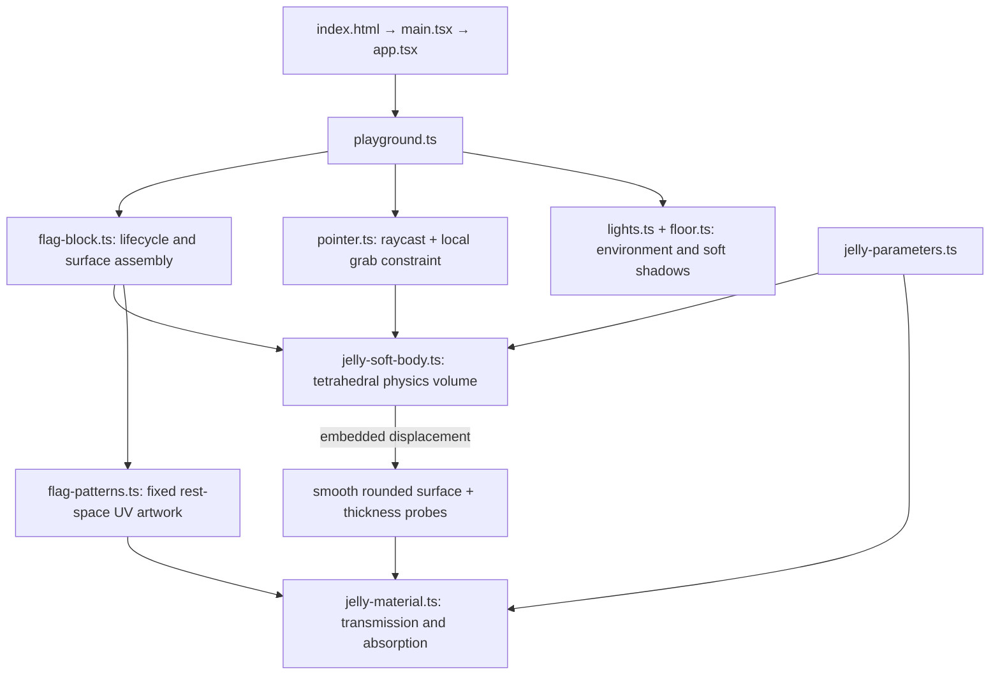

# Semesta

semesta means universe in Bahasa Indonesia. My mother tongue.
embarking my creative journey leveraging my background in Frontend engineering
into interactive digital arts✨

each semesta will be a personal space journey telling hidden stories but at the same time embedding a real app that i build on spare time

# Let's begin

A minimal Three.js learning workspace inside Semesta. React renders the canvas and country selectors; raw Three.js draws two deformable gummy flags in a pale pink world. Built with Vite, TypeScript and plain CSS.

```sh
npm ci
npm run dev
```

The same playground is available at `/` and `/countryjellies/`.

Select Indonesia, France, Nepal, Germany, Poland, Kazakhstan, or Brunei for either flag. Grab a region to stretch the jelly, then release to let it settle. Drag the empty background to pan; use the wheel to zoom. Mouse and touch use the same Pointer Events.

## How the files fit together



## Implementation and tuning

- **Physics:** each body has 189 particles and 576 tetrahedra. Distance constraints resist shear/stretch; signed tetrahedral volume constraints resist collapse. Velocities provide inertia and release overshoot. The fixed step is 1/120 second with at most six substeps per frame. Bottom particles anchor the contact patch; this is a grounded object, not a freely tumbling body. No inter-body collision solver is included.
- **Surface:** a dense rounded mesh follows the volume through trilinear embedding. Its positions and smooth normals update in place. The visible depth is 0.24, about 18% of its height. There is no separate rigid flag or global sine wobble.
- **Flag:** Country definitions select a shared `stripes` or `svg` pattern. Indonesia, France, Germany, and Poland supply ordered colours and stripe orientation; Kazakhstan, Brunei, and Nepal supply SVG artwork. SVG backgrounds and proportional insets are explicit per flag, preserving Nepal’s pink surround. Each country stores relative `size.width` and `size.height` dimensions (for example, France is 3:2 and Germany is 5:3). Texture width and mesh width derive from these proportions, with a shared texture height and display height. Outlines remain separate from artwork. UVs are assigned once from rest-space XY, including the edges, so they stretch with the material rather than swimming.
- **Material:** paired points embedded on the front/back of the volume estimate local thickness. This drives native physical transmission and Beer–Lambert colour absorption. It is a local-volume approximation, **not** a camera-ray back-face-depth pass; overlapping folds are not resolved. Roughness softens the highlights; the shadow-receiving floor grounds the bodies.
- **Compatibility:** this remains raw Three.js WebGL inside React, with no R3F/Drei. Tetrament was audited: it requires WebGPU compute/node materials, its npm name returned 404, and the Git repository's declared `dist` entry was absent. This project uses a small CPU position-based tetrahedral solver rather than adding an unpublished GPU dependency. It is not FEM and does not claim Tetrament feature parity.

Main controls are in `src/three/jelly-parameters.ts`:

| Desired change           | Parameter                                                          |
| ------------------------ | ------------------------------------------------------------------ |
| Softer                   | Lower `physics.stiffness` and `physics.recovery`                   |
| Firmer                   | Increase `physics.stiffness` or `physics.iterations`               |
| More jiggle              | Lower `physics.damping` (keep it positive)                         |
| Better volume retention  | Increase `physics.volumePreservation` or solver iterations         |
| Stronger local grab      | Increase `physics.grabStrength`; keep `maxStretch` bounded         |
| More translucent         | Increase `material.transmission`, lower `material.absorption`      |
| More gummy / less glassy | Increase `material.roughness` and `material.absorption` moderately |

The existing `camera.ts`, `scene.ts`, `renderer.ts`, and `resize.ts` keep camera, background, renderer, and resizing explicit. `app.tsx` owns only the canvas and selectors; no React state updates occur per physics frame. Country changes rebuild only the affected body, and cleanup disposes its geometry/material/texture plus scene lighting resources.

## Checks

`npm run check` runs formatting, lint, and TypeScript checks. `npm run build` creates the production bundle.

```sh
npm run check
npm run build
npm run preview
```

Code style and agent conventions are in `AGENTS.md`.

## Flag colour references

The palette audit uses the [German federal government's digital national colours](https://styleguide.bundesregierung.gov.de/sg-de/basiselemente/farben) for Germany and the [country-flags artwork collection](https://github.com/hampusborgos/country-flags/tree/main/svg) for the other flags. These are sRGB texture inputs, not guaranteed final screen colours under the jelly material.

| Country    | Texture palette                            | Audit result                                                                                                                                          |
| ---------- | ------------------------------------------ | ----------------------------------------------------------------------------------------------------------------------------------------------------- |
| Germany    | `#000000`, `#FF0000`, `#FFCC00`            | Corrected red from `#DD0000` and gold from `#FFCE00` to the federal digital palette.                                                                  |
| France     | `#051440`, `#FFFFFF`, `#EC1920`            | Changed blue from `#0055A4` to the navy in the provider's `fr.svg`; exact shades are an artwork choice.                                               |
| Indonesia  | `#FF0000`, `#FFFFFF`                       | Matches the provider's `id.svg`; retained.                                                                                                            |
| Poland     | `#FFFFFF`, `#DC143C`                       | Matches the provider's `pl.svg`; retained as a digital approximation, not a certified conversion of the statutory colour specification.               |
| Kazakhstan | `#00AFCA`, `#FEC50C`                       | Inspected fills in `kz.svg`; sky-blue field and gold details match the official colour description.                                                   |
| Brunei     | `#F7E017`, `#FFFFFF`, `#000000`, `#CF1126` | Inspected fills in `bn.svg`; yellow, white, black, and red match the official colour description.                                                     |
| Nepal      | `#DC143C`, `#003893`, `#FFFFFF`            | Inspected fills in `np.svg`; crimson, deep blue, and white match the constitutional description. The pink surround is part of the scene presentation. |

Official descriptions establish colour families without necessarily providing screen hex values: [France](https://www.elysee.fr/en/french-presidency/the-french-flag), [Indonesia](https://kab-nduga.kpu.go.id/blog/read/8404_makna-bendera-merah-putih), [Poland](https://eli.gov.pl/eli/DU/2024/155/ogl/pol), [Kazakhstan](https://mirror.akorda.kz/public/en/state_symbols/kazakhstan_flag), [Brunei](https://www.agc.gov.bn/SitePages/National%20Flag%20and%20Crest.aspx), and [Nepal](https://cdn.nestjs.wipolex.wji.prd.web1.wipo.int/wipolex/en/legislation/details/16153). The SVG sources track the provider's `main` branch, so their values can change upstream.

The texture is marked as sRGB. `jelly-material.ts` then applies colour-dependent absorption and transmission, while the pink surroundings and tinted reflection panels in `lights.ts` can shift its appearance. Source palette accuracy and the final illuminated appearance are separate checks; a large visible gold shift cannot be explained by the two-level green-channel correction alone. This audit preserves the existing jelly shading.
