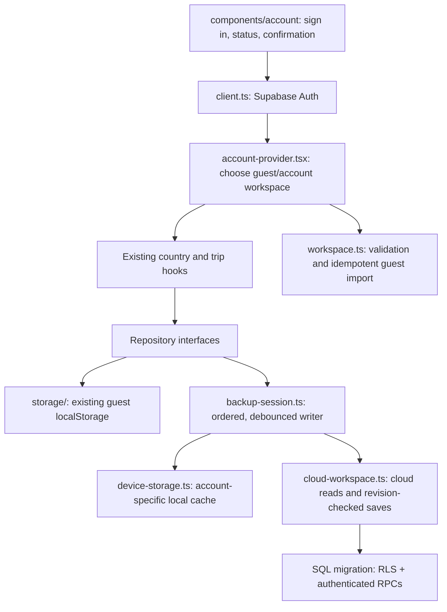

# Optional account backup

Semesta stays usable as a guest. Email codes and Google use Supabase Auth; accounts back up countries and trips to a private Supabase row. The frontend stays on Vercel. Apple and SMS are not included.

## Connect the services

1. Create a Supabase Free project. Run `supabase/migrations/202610100001_accounts.sql` in its SQL editor. This creates a private workspace table, an atomic revision-checked save function, and authenticated self-deletion. Do not disable RLS.
2. Copy `.env.example` to `.env.local`. Set `VITE_SUPABASE_URL` and `VITE_SUPABASE_PUBLISHABLE_KEY` using the project's public URL and publishable key. Set the same variables in Vercel, then redeploy. Never add a secret/service-role key to Vite variables.
3. In Supabase Authentication → URL Configuration, set Site URL to your production origin. Add exact allowed redirect URLs for your production `/` and `/countryjellies` routes, plus `http://localhost:5173/` and `http://localhost:5173/countryjellies` for development. Add a preview URL explicitly when testing a preview; avoid an unrestricted wildcard.
4. Enable Email authentication. Change the **Magic Link** email template to include the verification code: `
Your Semesta sign-in code is: {{ .Token }}
`. This is one signup/sign-in flow with no password. Configure a short code expiry, rate limits, and resend protection in Supabase. The UI also has a 60-second resend cooldown.
5. Configure **custom SMTP** (for example, Resend's free tier) with a verified domain you control. Supabase's built-in sender is for testing, not public production delivery. SMTP credentials belong in Supabase, never the browser. A domain may cost money if you do not already own one. Free email quotas apply; leave paid overages disabled if you want a hard spending limit.
6. Create a Google OAuth **Web application** in Google Cloud. Configure its consent screen and your app domain. Set its authorized redirect URI to the callback shown by Supabase (`https://PROJECT.supabase.co/auth/v1/callback`). Put the Google client ID and secret in Supabase's Google provider settings. While Google is in testing mode, add test users; publish the consent screen before general release. Request only basic sign-in scopes.
7. Restart `npm run dev`. Without public configuration, the account panel explains that backup is not connected and disables sign-in. Existing guest functionality remains available.

Official references: [email OTP](https://supabase.com/docs/guides/auth/auth-email-passwordless), [Google](https://supabase.com/docs/guides/auth/social-login/auth-google), [SMTP](https://supabase.com/docs/guides/auth/auth-smtp), [Resend domains](https://resend.com/docs/dashboard/domains/introduction).

## File responsibilities

- Guest storage keys remain unchanged. New accounts upload guest plans once. Existing accounts restore their cloud data; **Import guest plans from this device** is explicit. Matching trip IDs retain the account version. Import merges countries; it does not remove saved account selections.
- Account caches use the user ID, never the email address. Email and Google authentication do not change the storage format. Signing out clears that account's cache and returns to the separate guest workspace. Unsynced local account edits are removed only after the sign-out confirmation.
- Edits update the device cache immediately. Cloud writes are debounced and serialized. Offline changes retry every 30 seconds and on reconnection. **Backed up** means the server acknowledged the current snapshot.
- Every save compares the server revision. A stale tab/device cannot overwrite newer data. Conflicts preserve local changes and stop automatic writes. **Restore cloud version** explicitly discards the local account edits after confirmation. Automatic multi-device merging is outside this MVP.
- A failed initial cloud read without a cache disables account editing until retry or sign-out. It never uploads an empty fallback. Restoring a workspace does not trigger a save.
- Saved work is backed up; unsaved editor drafts are not. Drafts reset when changing accounts, while the Three.js renderer stays mounted.
- Deleting an account removes its Auth user and cloud workspace through an authenticated self-deletion function. Guest plans stay separate. There are no shared trips, profile setup, or account linking controls. Users should use the same sign-in identity on their devices; do not manually merge unrelated identities by email.

## Release checks that need a real project

Local tests use mocked Auth/cloud responses. Before release, verify:

- Real email delivery, wrong/expired codes, resend limits, and Google redirects on desktop/mobile.
- New signup uploads guest plans; a second browser restores them.
- Two users cannot read/write/delete each other's workspace; anonymous calls cannot access account data.
- Two tabs editing the same revision produce a conflict rather than a lost update.
- Offline edits survive reload and retry when reconnected.
- Sign-out returns to guest data; deleting a test account removes its cloud row and prevents further access.

`npm run check` covers validation, migration, save ordering, retry/conflict handling, auth UI and account lifecycle. `npm run build` validates the production bundle. Free-tier quotas and provider settings must be monitored in their dashboards; the app does not enable paid upgrades.
